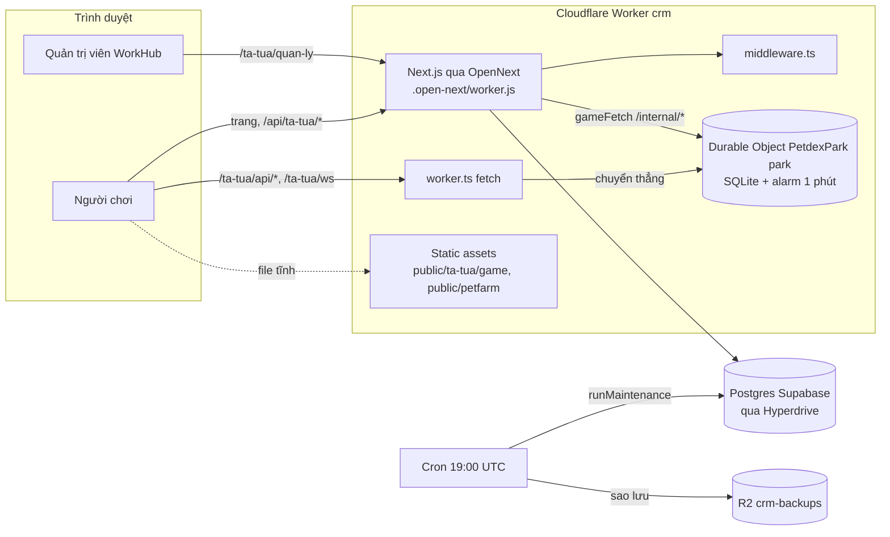

# Tổng quan hạ tầng

> [!summary]
> Pet Town không có máy chủ riêng: nó chạy **bên trong Worker `crm` của WorkHub** trên Cloudflare. Ứng dụng Next.js (đóng gói bằng OpenNext) phục vụ trang web, còn toàn bộ máy chủ game nằm trong **một Durable Object** tên `park` có SQLite riêng. Ba tên miền Petfarm cùng trỏ vào Worker này, và `middleware.ts` quyết định mỗi tên miền được thấy gì. Hiểu sơ đồ này là hiểu mọi ghi chú khác trong [[MOC Vận hành]].

## Sơ đồ tổng thể

## Các lớp

| Lớp | Việc | Ở đâu | Nguồn |
|---|---|---|---|
| Worker | Điểm vào: tách request game ra khỏi Next.js, chạy cron | `worker.ts` | `worker.ts:39-46` |
| Durable Object | Toàn bộ máy chủ game, một object duy nhất `park` | `petdex/server/durable.js` | `worker.ts:13`, `worker.ts:35` |
| Next.js | WorkHub, trang chơi, trang mời, bảng quản lý, trang giới thiệu, wiki | `app/` | `worker.ts:41` |
| Middleware | Định tuyến theo tên miền, cổng đăng nhập, chống CSRF | `middleware.ts` | `middleware.ts:20-81` |
| Giao diện game | HTML/JS tĩnh trong iframe | `public/ta-tua/game/` | `lib/petdex-public.ts:38` |
| Cơ sở dữ liệu WorkHub | Postgres (người dùng, nhật ký thao tác) | Supabase Singapore qua Hyperdrive | `wrangler.jsonc:35-41` |
| Dữ liệu game | SQLite của Durable Object (không nằm trong Postgres) | storage của object | `petdex/server/durable.js:26` |

## Ba đường vào máy chủ game
1. **API game** `/ta-tua/api/*` và **công viên** `/ta-tua/ws`: Worker chuyển thẳng vào Durable Object, không qua Next.js (`worker.ts:29-37`). API tự kiểm tra token Bearer ([[Phiên chơi và token]]).
2. **API nội bộ** `/internal/*`: chỉ gọi được từ code server của Next.js qua binding `PETDEX` (`lib/petdex.ts:31-50`). Không có đường public nào tới nó ([[Đăng nhập một lần WorkHub]], [[API cầu nối WorkHub]]).
3. **File tĩnh** `/ta-tua/game/*`: phục vụ như static asset, không qua middleware ở production.

## Ba tên miền
Xem [[Tên miền Petfarm]]: `petfarm.online` (giới thiệu), `play.petfarm.online` (chơi), `wiki.petfarm.online` (hướng dẫn), cộng tên miền WorkHub `crm.<subdomain>.workers.dev` nơi nhân viên chơi trong khung và quản trị viên mở [[Bảng quản lý Pet Town]].

## Chạy trên máy (dev)
| Thành phần | Lệnh | Ghi chú | Nguồn |
|---|---|---|---|
| Máy chủ game Node | `npm run petdex:dev` (cổng 3200) | Cần header `x-petdex-internal` cho `/internal/*`, mặc định `dev` ngoài production | `petdex/server/index.js:6`, `petdex/server/index.js:23`, `petdex/server/index.js:96-101` |
| Next.js | `npm run dev` | Rewrite `/ta-tua/api/*` sang cổng 3200 | `next.config.mjs:68-73` |
| WebSocket | nối thẳng `ws://127.0.0.1:3200/ta-tua/ws` | `next dev` không proxy WebSocket, nên địa chỉ ws đi qua `#ws=` | `lib/petdex.ts:75-76`, `components/tatua/play-screen.tsx:15` |

> [!info] Cùng một mã chạy hai nơi
> Máy chủ game gốc dùng Express, socket.io và `node:sqlite`. Bản trong repo thay bằng router nhỏ, hub WebSocket và lớp SQL cắm được để chạy được cả trên Node lẫn Workers. Xem [[Kiến trúc máy chủ]] và [[Quyết định thiết kế]].

## Liên quan
- [[Worker và wrangler]]
- [[Middleware định tuyến]]
- [[Durable Object PetdexPark]]
- [[Kiến trúc máy chủ]]
- [[Bản đồ hệ thống]]
- [[MOC Vận hành]]
