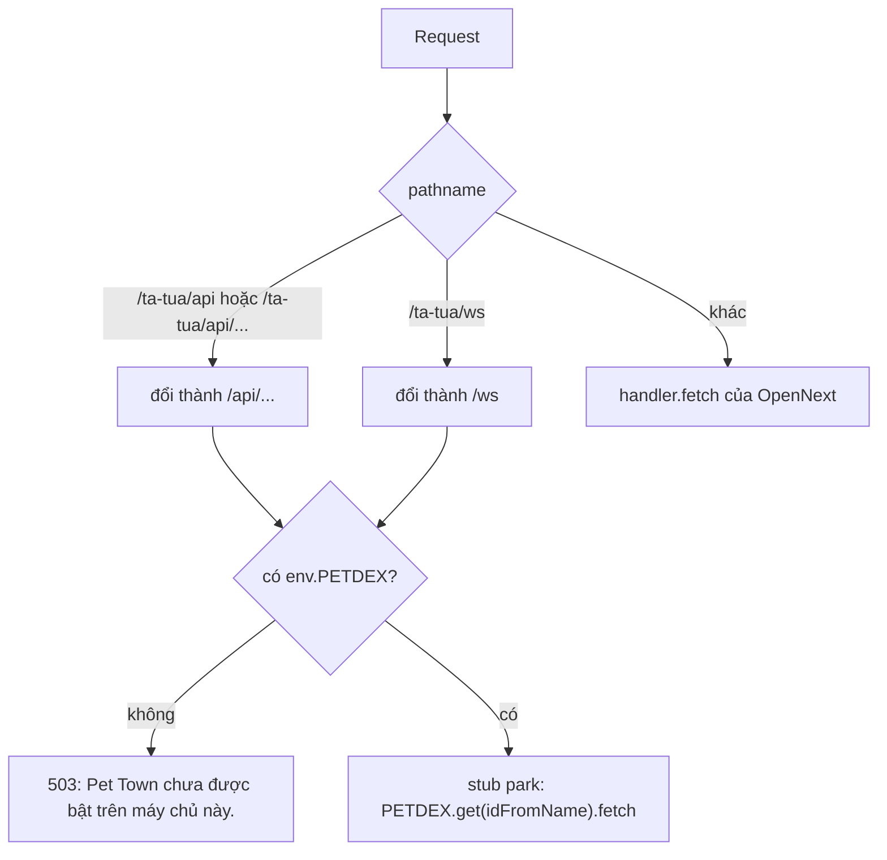

# Worker và wrangler

> [!summary]
> `worker.ts` là điểm vào của Worker `crm`: nó bọc ứng dụng OpenNext, chuyển hai đường dẫn của game vào Durable Object `park`, và chạy cron bảo trì hằng ngày. `wrangler.jsonc` khai báo mọi binding (Durable Object, Hyperdrive, R2, rate limit, assets). Ghi chú này chỉ nêu **tên** binding, không bao giờ chép giá trị bí mật.

## worker.ts: định tuyến

| Quy tắc | Chi tiết | Nguồn |
|---|---|---|
| Nhận diện API | `pathname === "/ta-tua/api"` hoặc bắt đầu bằng `/ta-tua/api/` | `worker.ts:31` |
| Nhận diện công viên | đúng `/ta-tua/ws` | `worker.ts:32` |
| Viết lại đường dẫn | bỏ tiền tố `/ta-tua` cho API; WebSocket thành `/ws` | `worker.ts:34` |
| Chưa có binding | trả JSON 503 "Pet Town chưa được bật trên máy chủ này." | `worker.ts:33` |
| Chọn object | luôn `idFromName("park")`: một object duy nhất cho cả game | `worker.ts:35` |
| Còn lại | `handler.fetch(request, env, ctx)` của OpenNext | `worker.ts:41` |
| Cron | `scheduled` gọi `runMaintenance(env)` trong `waitUntil` | `worker.ts:43-45` |
| Re-export | `PetdexPark` từ `petdex/server/durable.js`; `DOQueueHandler`, `DOShardedTagCache`, `BucketCachePurge` từ bản build OpenNext | `worker.ts:13`, `worker.ts:18` |

Bên trong object, `fetch` tách tiếp: `/ws` (cần header `upgrade: websocket`, không có thì 426 "Cần WebSocket."), `/api/*`, `/internal/*`, còn lại 404 "Không tìm thấy." (`petdex/server/durable.js:53-67`). IP người chơi lấy từ `cf-connecting-ip` (`petdex/server/durable.js:55`). Xem [[Durable Object PetdexPark]].

## wrangler.jsonc: các khai báo

| Khóa | Giá trị (không bí mật) | Ý nghĩa | Nguồn |
|---|---|---|---|
| `name` | `crm` | Tên Worker; URL `crm.<account-subdomain>.workers.dev` | `wrangler.jsonc:4` |
| `main` | `worker.ts` | Điểm vào | `wrangler.jsonc:6` |
| `compatibility_date` | `2026-10-01` | | `wrangler.jsonc:7` |
| `compatibility_flags` | `nodejs_compat`, `global_fetch_strictly_public` | Next.js, Prisma, `pg` cần `nodejs_compat` | `wrangler.jsonc:9` |
| `assets` | thư mục `.open-next/assets`, binding `ASSETS` | File tĩnh (cả game và ảnh trang giới thiệu) | `wrangler.jsonc:11-14` |
| `placement` | `targeted`, vùng `aws:ap-southeast-1` | Chạy cạnh Postgres Singapore | `wrangler.jsonc:18-21` |
| `observability` | bật | Log trên Cloudflare | `wrangler.jsonc:22-24` |
| `vars.APP_TIMEZONE` | `Asia/Ho_Chi_Minh` | Múi giờ của job bảo trì | `wrangler.jsonc:27-29` |
| `hyperdrive` | binding `HYPERDRIVE` | Pool kết nối Postgres; `lib/prisma.ts` ưu tiên binding này | `wrangler.jsonc:35-41` |
| `r2_buckets` | `CONTRACT_FILES` (`crm-contract-files`), `BACKUPS` (`crm-backups`) | PDF hợp đồng và sao lưu hằng ngày | `wrangler.jsonc:45-48` |
| `triggers.crons` | `0 19 * * *` | 19:00 UTC = 02:00 giờ Việt Nam | `wrangler.jsonc:50-52` |
| `durable_objects` | binding `PETDEX`, lớp `PetdexPark` | Máy chủ game | `wrangler.jsonc:55-57` |
| `migrations` | tag `petdex-v1`, `new_sqlite_classes: ["PetdexPark"]` | Object dùng SQLite | `wrangler.jsonc:58` |
| `ratelimits` | `LOGIN_LIMITER` (5 lần/60 giây), `LOGIN_IP_LIMITER` (30 lần/60 giây) | Xem [[Giới hạn tần suất]] | `wrangler.jsonc:61-64` |

> [!warning] Bí mật không nằm trong file
> `JWT_SECRET` (và `DATABASE_URL` khi không dùng Hyperdrive) đặt ở Cloudflare: *Worker → Settings → Variables and Secrets* (`wrangler.jsonc:25-26`). `localConnectionString` của Hyperdrive chỉ dùng cho `npm run preview` với Postgres local. Vault không chép các giá trị này.

## Hai cách game được gọi
| Ai gọi | Đường | Cách | Nguồn |
|---|---|---|---|
| Trình duyệt | `/ta-tua/api/*`, `/ta-tua/ws` | qua `worker.ts` | `worker.ts:29-37` |
| Code server Next.js | `https://petdex.internal/internal/...` | `gameFetch` gọi thẳng stub, không lên mạng | `lib/petdex.ts:34-38` |

`lib/petdex.ts` có ba hàm chính:
- `gameFetch(path, { method, body })`: method mặc định GET nếu không có body, POST nếu có; trên Workers dùng stub, trên máy dùng `PETDEX_URL` (mặc định `http://127.0.0.1:3200`) kèm header `x-petdex-internal` (`lib/petdex.ts:28-50`). Máy chủ dev chưa chạy thì ném `GameError` 503 "Máy chủ game chưa chạy (npm run petdex:dev)." (`lib/petdex.ts:48`).
- `gameJson<T>(path)`: lỗi HTTP thì ném `GameError(message, status, reason)` với thông báo tiếng Việt của game, mặc định "Máy chủ game gặp sự cố." (`lib/petdex.ts:53-58`).
- `memberSession(user)`: gọi `/internal/sso` ([[Đăng nhập một lần WorkHub]]) (`lib/petdex.ts:67-69`). `gameFrameUrl(token)` dựng địa chỉ iframe với token trong fragment (`lib/petdex.ts:73-78`).

## Liên quan
- [[Tổng quan hạ tầng]]
- [[Durable Object PetdexPark]]
- [[Sao lưu dữ liệu]]
- [[Quy trình deploy]]
- [[MOC Vận hành]]
