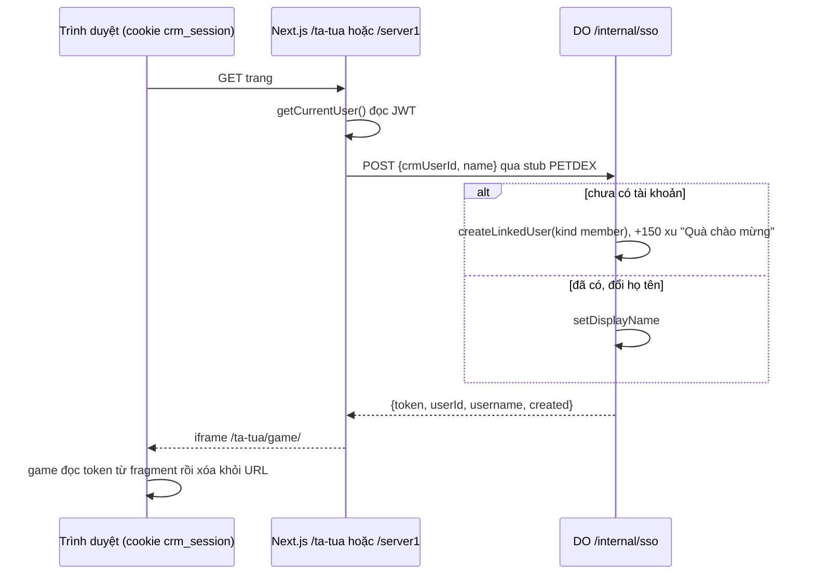

# Đăng nhập một lần WorkHub

> [!summary]
> Nhân viên WorkHub không cần tài khoản game riêng: lần đầu mở mục **Pet Town**, server Next.js gọi `/internal/sso` của Durable Object với mã người dùng WorkHub và họ tên, game tạo tài khoản loại `member` (150 xu chào mừng) và trả token chơi. Các lần sau dùng lại token còn mới (dưới 7 ngày) thay vì tạo phiên mới. Nhân viên cũng chơi được trên `play.petfarm.online/server1` sau khi đăng nhập WorkHub một lần trên tên miền đó.

## Luồng

## Quy tắc
| Quy tắc | Chi tiết | Nguồn |
|---|---|---|
| Khóa liên kết | `users.crm_user_id` = id WorkHub | `petdex/server/internal.js:98-99` |
| Tên | họ tên WorkHub, gộp khoảng trắng, **cắt** còn 40 ký tự (không từ chối như với khách) | `petdex/server/internal.js:46-52`, `petdex/server/internal.js:96` |
| Tên đăng nhập | sinh từ tên (xem [[Link mời]]) | `petdex/server/internal.js:28-44` |
| Cập nhật tên | đổi họ tên ở WorkHub thì lần mở sau tên hiển thị đổi theo | `petdex/server/internal.js:103-104` |
| Bị khóa | "Tài khoản chơi của bạn đã bị quản trị viên khóa." | `petdex/server/internal.js:106` |
| Tái dùng phiên | `recentToken(userId, 7 ngày)` rồi mới `issueToken` | `petdex/server/db.js:820`, `petdex/server/internal.js:107` |
| `created` | `true` khi người này chưa từng hoạt động (`last_seen_at` rỗng) | `petdex/server/internal.js:107` |
| Token trong fragment | `#token=...` không bao giờ vào log máy chủ; game đọc xong gọi `history.replaceState` | `lib/petdex.ts:71-78`, `public/ta-tua/game/js/app.js:7-19` |
| `who=member` | game lưu `sessionStorage["petdex.who"]="member"` và ẩn nút đăng xuất của game | `public/ta-tua/game/js/app.js:12-24` |

## Phiên WorkHub (bên ngoài game)
| Thông số | Giá trị | Nguồn |
|---|---|---|
| Cookie | `crm_session`, httpOnly, `SameSite=Lax`, `secure` ở production | `lib/jwt.ts:4`, `lib/jwt.ts:44-46` |
| Thời hạn | 7 ngày | `lib/jwt.ts:5` |
| Đăng nhập | `/login`, `/api/auth/login` (có giới hạn tần suất, xem [[Giới hạn tần suất]]) | `app/api/auth/login/route.ts:37-48` |
| Quản trị viên | `user.role === "ADMIN"` | `lib/rbac.ts:5-7` |

> [!info] Mỗi tên miền một cookie
> Cookie `crm_session` gắn với host. Đăng nhập ở tên miền WorkHub không làm `play.petfarm.online` biết bạn là ai; phải đăng nhập lại một lần ở `play.petfarm.online/login?next=/server1`. Middleware cho phép `/login`, `/api/auth`, `/change-password` trên tên miền game đúng vì lý do này (`lib/petdex-public.ts:89`).

## Trong thanh bên WorkHub
Mục "Pet Town" (`/ta-tua`) ở cuối thanh bên cho mọi người; "Quản lý Pet Town" (`/ta-tua/quan-ly`) chỉ cho admin (`components/layout/app-shell.tsx:73-75`). Trong khung game, admin thấy thêm nút *Quản lý* (`app/(app)/ta-tua/game-frame.tsx:19-23`).

## Thêm mật khẩu cho tài khoản nhân viên
Tài khoản `member` ban đầu không có mật khẩu. Người chơi được nhắc bổ sung tên đăng nhập + mật khẩu (`CredentialsNotice`) để có thể vào `play.petfarm.online` mà không cần WorkHub. Xem [[Tài khoản người chơi]] và [[Link đặt mật khẩu]].

## Liên quan
- [[Phiên chơi và token]]
- [[Trang chơi server1]]
- [[API nội bộ]]
- [[Worker và wrangler]]
- [[MOC Vận hành]]
