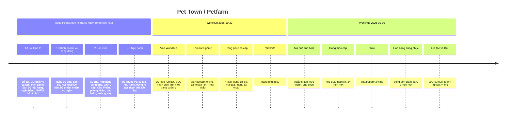

# Lộ trình phát triển

> [!summary]
> Pet Town đi qua hai chặng. **Chặng Petdex** (trước khi vào WorkHub, trong repo gốc): giai đoạn 1A, 1B, 2 của [[Tài liệu thiết kế mở rộng]] và 2.5A/B/C của [[Thiết kế pet ngũ hành]], tất cả đã xong. **Chặng WorkHub** (từ 2026-10-29): đưa game vào Cloudflare, tên miền riêng, tài khoản, trang phục có cấp, mã quà, trang giới thiệu, wiki, rồi **Gia tộc & Đất** thay cho phần bất động sản của giai đoạn 3. Còn lại chưa làm: thám hiểm, hội thi, nội thất, đấu giá, hợp đồng tương lai, Sở Giao Dịch.

## Dòng thời gian

## Trạng thái từng hạng mục

| Hạng mục | Giai đoạn thiết kế | Trạng thái | Ở đâu trong vault |
|---|---|---|---|
| Nhịp tuổi 1 ngày = 1 tuần | 1A | đang chạy | [[Giai đoạn tuổi]] |
| Sổ cái, Ví, báo cáo | 1A | đang chạy | [[Sổ cái]], [[Ví và tài sản ròng]] |
| Nghề, ca làm, kỹ năng | 1A | đang chạy | [[Việc làm]], [[Kỹ năng]] |
| Mini-game câu cá, hứng trân châu, ghép hình | 1A | đang chạy | [[Mini-game]] |
| Sàn Nguyên Liệu, tin tức, kho theo lô | 1A | đang chạy | [[Sàn Nguyên Liệu]] |
| Tiết kiệm, gửi kỳ hạn, Ngân hàng Trung ương | 1A | đang chạy | [[Ngân hàng Trân Châu]], [[Ngân hàng Trung ương]] |
| Công tắc Tài chính nâng cao | 1A | đang chạy (`advancedFinance: true`) | `petdex/server/settings.js:5-6` |
| Quầy trà sữa, thuê bé người khác | 1B | đang chạy | [[Quầy trà sữa]], [[Thuê bé làm việc]] |
| Bạn bè, Hội (quỹ, 2 nâng cấp, dự án tuần) | 1B | đang chạy | [[Bạn bè]], [[Hội]] |
| Thuế thu nhập lũy tiến, ngân sách, bỏ phiếu | 1B | đang chạy | [[Thuế thu nhập]], [[Tòa thị chính]] |
| Xưởng, gia công thuê, hợp đồng cung ứng | 2 | đang chạy | [[Khu công nghiệp]], [[Hợp đồng cung ứng]] |
| Vườn, bếp, Chợ Phiên | 2 | đang chạy | [[Vườn]], [[Bếp]], [[Chợ Phiên]] |
| Sạch sẽ, Sức khỏe, phòng khám, bảo hiểm | 2 | đang chạy | [[Ốm và Phòng khám]] |
| Vay tín chấp, điểm tín dụng | 2 | đang chạy | [[Tín dụng và vay]] |
| Bộ khung vẽ, ngũ hành, trứng, vòng đời | 2.5 | đang chạy | [[Thiết kế pet ngũ hành]] |
| Gia tộc, 200 lô đất, Sở Nhà Đất mua/bán lại, thuế doanh nghiệp, vĩ mô | (thay cho phần đất của 3) | đang chạy từ `05840b3` | [[Clan]], [[Bản đồ đất]] |
| Xếp hạng tài sản ròng | 3 | đang chạy (Bảng vàng theo tài sản ròng) | [[Bảng vàng]] |
| Nhà ở cho thuê, người thuê NPC, thuế tài sản, cải tạo, thế chấp | 3 | **chưa làm** | |
| Đấu giá (Chợ Phiên, đất) | dời từ 2 sang 3 | **chưa làm** | |
| Quầy chung của Hội | dời từ 1B sang 3 | **chưa làm** | |
| Bảo hiểm kinh doanh, sự cố ngẫu nhiên ở quầy/xưởng | dời từ 2 sang 3 | **chưa làm** | |
| Thám hiểm, hội thi tuần, nội thất, thăm nhà có nội thất | 3 | **chưa làm** | |
| Hợp đồng tương lai, Sở Giao Dịch, quỹ chỉ số, gọi vốn, sự kiện mùa | 4 | **chưa làm** | |

## "Sở Nhà Đất sắp mở"
Bản đồ phố có cơ chế ô "Sắp mở": địa điểm có `soon` hiện mờ với chữ khóa riêng (`public/ta-tua/game/js/views/map.js:6`, `public/ta-tua/game/js/views/map.js:44-51`). Trước `05840b3`, ô 🏘️ là "Sở Nhà Đất" với `soon: 'Sắp mở: nhà đất cho thuê'`. Commit `05840b3` (2026-10-30) đổi thành "Gia tộc & Nhà Đất", mở màn `clans` khi đủ cấp gia tộc (`level: 'clan'`, `public/ta-tua/game/js/views/map.js:25`). Hiện **không còn** địa điểm nào mang `soon`; nhưng phần "nhà đất cho thuê" nguyên bản vẫn chưa có. Xem [[Màn Phố]].

## Điều kiện kết thúc một giai đoạn (theo thiết kế)
Có test cho luật mới; mô phỏng kinh tế đạt tiêu chí mục 9; đã chơi thử trên trình duyệt với 2 người (`petdex/docs/thiet-ke-mo-rong.md:744-748`). Trong WorkHub, thêm điều kiện CI xanh và quy trình deploy ([[CI và smoke test]], [[Quy trình deploy]]).

## Liên quan
- [[Lịch sử phiên bản]]
- [[Quyết định thiết kế]]
- [[Tài liệu thiết kế mở rộng]]
- [[MOC Thiết kế]]
