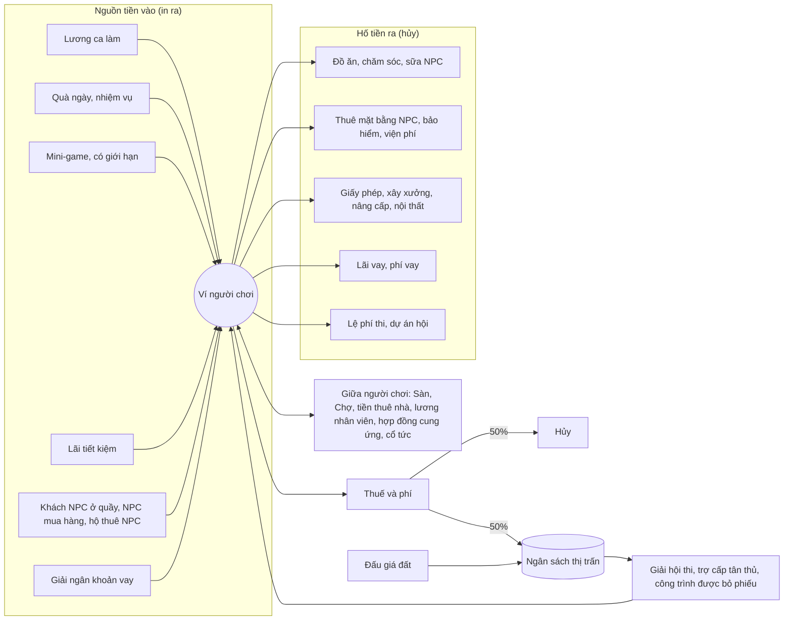

# Petdex Park mở rộng: Phố Trân Châu

Bản thiết kế cho phiên bản lớn tiếp theo, gồm hai trục:

- **Nhiều hoạt động hơn:** mỗi lần mở app đều có việc để làm (vòng ngắn), có mục tiêu vài ngày (vòng giữa) và có ước mơ dài hạn (vòng dài).
- **Nền kinh tế có chiều sâu:** tiền vừa là phần thưởng, vừa là một trò chơi riêng, với tiết kiệm, kinh doanh, chế biến, bất động sản, thuế, vay, hợp đồng tương lai và cổ phiếu.

> Tài liệu này để duyệt trước khi code. Các con số là điểm khởi đầu và sẽ được chỉnh lại bằng mô phỏng kinh tế (mục 9).

---

## 1. Hiện trạng và vấn đề

| Đã có | Vấn đề |
| --- | --- |
| Chăm sóc 3 chỉ số, tuổi, cấp, cửa hàng 16 món, công viên nhiều người | Ít việc để làm: vào app chỉ có cho ăn, chơi, đi làm |
| Đi làm `22 + 3·cấp` xu, tốn 30 năng lượng | Bấm liên tục được: năng lượng hồi 288/ngày nên được khoảng 9 lần, hơn 300 xu/ngày mà gần như không tốn thời gian |
| Một loại tiền, chỉ tiêu ở cửa hàng NPC | Không có chỗ tiêu tiền lớn nên tiền sẽ ứ đọng, xu mất giá; không có quyết định tài chính nào |
| Tương tác người chơi: vuốt ve, tặng quà | Không có kinh tế giữa người chơi với nhau |
| Bé trưởng thành sau 21 giờ | Quá nhanh so với các mục tiêu tính bằng tuần |

---

## 2. Quyết định đã chốt

| Câu hỏi | Quyết định |
| --- | --- |
| Vay nợ, đầu cơ phái sinh, thi có lệ phí | Gom vào chế độ **Tài chính nâng cao**: mở ở cấp 8, người chơi tự bật, server có cờ tắt hẳn (mục 6.1) |
| Nhịp tuổi | **1 ngày thật = 1 tuần tuổi.** Bé trưởng thành sau khoảng 3 tuần thật (mục 4.4) |
| Ưu tiên | Đưa **quầy trà sữa, Sàn Nguyên Liệu, mini-game, bạn bè và hội** vào giai đoạn 1 (mục 10) |
| Quy mô | **Sâu hơn nữa:** thêm bất động sản cho thuê, thuế lũy tiến và ngân sách thị trấn, chuỗi cung ứng, hợp đồng tương lai |
| Giờ quyết toán | Nửa đêm giờ Việt Nam (UTC+7) |

---

## 3. Bản đồ Phố Trân Châu

Thay thanh tab bằng một **bản đồ phố pixel** (cùng phong cách với phòng và công viên). Mỗi tòa nhà là một nhóm hoạt động. Thanh dưới cùng giữ 5 lối tắt: Nhà, Bản đồ, Túi đồ, Ví, Công viên.

| Địa điểm | Hoạt động | Mở khóa |
| --- | --- | --- |
| 🏠 Nhà | Chăm sóc, tắm, ngủ, trang trí nội thất | Có sẵn |
| 🌳 Công viên | Gặp gỡ, chat, vuốt ve, tặng quà, trò chơi nhóm | Có sẵn |
| 🎣 Hồ câu và 🎮 Khu trò chơi | Mini-game | Có sẵn |
| 🏪 Siêu thị | Cửa hàng NPC (giá theo chỉ số giá của thị trấn) | Có sẵn |
| 🩺 Phòng khám | Khám chữa bệnh, bảo hiểm | Có sẵn |
| 📰 Báo Trân Châu | Tin tức thị trường, lãi suất, thuế, kết quả bỏ phiếu | Có sẵn |
| 💼 Trung tâm việc làm | Nghề nghiệp, ca làm, tin tuyển nhân viên | Bé tròn 2 tuần tuổi |
| 🏫 Trường học | Lớp luyện kỹ năng | Cấp 2 |
| 🌱 Vườn | Trồng chè, dâu, mía, sắn; bạn bè tưới hộ | Cấp 2 |
| 🏦 Ngân hàng | Tiết kiệm, gửi kỳ hạn; vay và thế chấp (chế độ nâng cao) | Cấp 3 |
| 🍳 Bếp | Nấu món từ nguyên liệu, khám phá công thức | Cấp 3 |
| 📈 Sàn Nguyên Liệu | Mua bán 10 loại nguyên liệu theo giá thời gian thực; hợp đồng tương lai (nâng cao) | Cấp 2 (để bán được cá và trân châu từ mini-game ngay từ đầu) |
| 🛒 Chợ Phiên | Người chơi rao bán đồ cho nhau, đấu giá đồ hiếm | Cấp 4 |
| 🏛️ Tòa thị chính | Thuế, ngân sách thị trấn, bỏ phiếu chi tiêu | Cấp 5 |
| 🧋 Quầy của bạn | Mở quầy trà sữa: nhập hàng, đặt giá, thuê nhân viên | Cấp 6 |
| 🏭 Khu công nghiệp | Xưởng chế biến, gia công thuê, hợp đồng cung ứng | Cấp 8 |
| 🏘️ Sở Nhà Đất | Mua bán, cho thuê, đấu giá nhà và mặt bằng | Cấp 8 |
| 🧭 Cổng thám hiểm | Gửi bé đi thám hiểm vài giờ | Bé tuổi Thiếu niên |
| 🏆 Nhà thi đấu | Hội thi tuần (miễn phí; có lệ phí ở chế độ nâng cao) | Cấp 6 |
| 🏛️ Sở Giao Dịch | Cổ phiếu, quỹ chỉ số, gọi vốn (chế độ nâng cao) | Cấp 12 |

Mở khóa dần theo cấp để người mới không bị ngợp, và để mỗi lần lên cấp đều có thứ mới.

---

## 4. Thú cưng sâu hơn

### 4.1 Chỉ số sinh tồn (5 thay vì 3)

| Chỉ số | Thay đổi mỗi giờ | Hồi bằng |
| --- | --- | --- |
| 🍙 No bụng | −8 | Đồ ăn |
| 💖 Vui vẻ | −4 (gấp đôi khi đói hoặc bẩn) | Chơi, bạn bè, nội thất đẹp |
| ⚡ Năng lượng | +12 khi rảnh, −10 khi đang làm việc | Ngủ (+25/giờ), nước tăng lực |
| 🫧 Sạch sẽ **(mới)** | −5 | Tắm (miễn phí ở nhà, tốn 15 phút), đồ chăm sóc |
| ❤️ Sức khỏe **(mới)** | −3 khi đói hoặc bẩn dưới 20, +2 khi mọi chỉ số trên 50 | Tự hồi, thuốc, phòng khám |

Khi Sức khỏe dưới 40, mỗi giờ có 3% khả năng bé **ốm** (cảm, đau bụng). Bé ốm không đi làm, không trực quầy, không thám hiểm được, và Vui vẻ giảm gấp đôi cho đến khi chữa.

### 4.2 Kỹ năng (0–100)

| Kỹ năng | Dùng cho |
| --- | --- |
| 💪 Sức mạnh | Nghề bốc vác, công nhân xưởng, thám hiểm núi |
| 🏃 Nhanh nhẹn | Giao hàng, đua tốc độ, câu cá |
| 🧠 Thông minh | Gia sư, đố vui, xem trước tin tức thị trường |
| ✨ Duyên dáng | Ca sĩ, thi sắc đẹp, kéo khách cho quầy |
| 🖐️ Khéo tay | Pha chế, nấu ăn (chất lượng món), làm vườn, năng suất xưởng |

Kỹ năng tăng nhờ học ở trường, làm nghề tương ứng, chơi mini-game và thám hiểm. Càng cao tăng càng chậm: điểm nhận được nhân với `1 − kỹ_năng/150`.

### 4.3 Tính cách (bốc ngẫu nhiên 1–2 khi nhận nuôi)

| Tính cách | Hiệu ứng |
| --- | --- |
| Tham ăn | No bụng giảm nhanh 20%, đồ ăn cho thêm 30% XP |
| Chăm chỉ | +10% lương |
| Ham chơi | Chơi được thêm 50% vui vẻ |
| Ngủ nướng | Ngủ hồi năng lượng +20%, lương −5% |
| Có duyên | +5 Duyên dáng ban đầu, khách ở quầy +10% |
| Mọt sách | Học +25% |

Tính cách làm mỗi bé khác nhau và tạo lý do nuôi nhiều bé.

### 4.4 Nhịp tuổi mới: 1 ngày thật = 1 tuần tuổi

| Giai đoạn | Tuổi | Tương đương ngày thật | Mở ra |
| --- | --- | --- | --- |
| Sơ sinh | dưới 2 tuần | ngày 0–1 | Chăm sóc, mini-game |
| Nhí nhố | 2–8 tuần | ngày 2–7 | Nghề nghiệp, trực quầy |
| Thiếu niên | 8–21 tuần | ngày 8–20 | Thám hiểm, hội thi hạng Bạc |
| Trưởng thành | 21–60 tuần | ngày 21–59 | Bậc nghề 4–5, hội thi hạng Vàng |
| Lão làng | từ 60 tuần | từ ngày 60 | Dẫn dắt: bé khác chơi cùng được +20% XP |

- Tuổi hiển thị dạng "3 tuần 2 ngày tuổi".
- Kích thước sprite vẫn lớn dần theo giai đoạn.
- **Chuyển dữ liệu:** bé đang nuôi được đặt lại `born_at` để giữ nguyên giai đoạn hiện tại.

---

## 5. Hoạt động

### 5.1 Nghề nghiệp và ca làm (thay cho nút "Đi làm")

Ca làm tốn **thời gian thật**: chọn ca 1, 2 hoặc 4 giờ. Trong lúc làm, bé bận (không chơi, không trực quầy được), rồi về nhận lương, kể cả khi người chơi đã tắt app. Cách này bịt lỗ hổng bấm liên tục và làm cho thời gian có giá trị.

| Nghề | Kỹ năng chính | Lương/giờ theo bậc 1→5 |
| --- | --- | --- |
| 🧋 Pha chế | Khéo tay | 14 · 20 · 28 · 38 · 52 |
| 📦 Giao hàng | Nhanh nhẹn | 15 · 21 · 29 · 39 · 54 |
| 🏋️ Bốc vác | Sức mạnh | 16 · 22 · 30 · 40 · 55 |
| 📚 Gia sư | Thông minh | 13 · 20 · 30 · 42 · 58 |
| 🎤 Ca sĩ đường phố | Duyên dáng | 10 · 16 · 24 · 36 · 50, **cộng tiền boa ngẫu nhiên 0–60%** |

- `lương = lương_bậc × (0.8 + kỹ_năng/200) × hệ_số_tính_cách × số_giờ`
- Mỗi giờ làm tốn 10 năng lượng và 4 no bụng (cộng vào mức giảm sẵn có). Mỗi ngày làm tối đa 8 giờ, tính chung cho ca làm, trực quầy và đứng xưởng.
- Lên bậc cần đủ giờ làm của nghề đó (16 / 60 / 150 / 300 giờ) và kỹ năng chính đạt 20 / 40 / 60 / 80. Mỗi giờ làm tăng 0,6 điểm kỹ năng chính, giảm dần khi kỹ năng cao. Làm đủ 8 giờ/ngày thì khoảng 5 tuần lên bậc 5. Mô phỏng cho thấy mốc ban đầu (khoảng 10 ngày) đẩy lương trung bình lên gấp đôi dự kiến. Lên bậc thì có thông báo thăng chức; danh hiệu trên bảng tên ở công viên làm sau.
- Đổi nghề thì giữ lại bậc của nghề cũ, nên người chơi có thể làm nhiều nghề.
- **Việc làm thuê cho người chơi:** quầy và xưởng của người khác đăng tin tuyển. Lương do chủ trả, xu đi thẳng giữa hai người chơi chứ không in thêm.

### 5.2 Mini-game (mỗi lượt tốn 5 năng lượng)

| Trò | Cách chơi | Phần thưởng |
| --- | --- | --- |
| 🎣 Câu cá | Bấm đúng lúc thanh căng dây vào vùng xanh | Cá (5 loại theo độ hiếm), thỉnh thoảng nhặt được đồ; +Nhanh nhẹn |
| 🧋 Hứng trân châu | Di cốc hứng trân châu rơi, tránh đá | Xu theo điểm, phần trân châu |
| 🧩 Ghép hình nhớ | Lật cặp thẻ giống nhau | Xu; +Thông minh |

- Xu từ mini-game bị giới hạn **120 xu/ngày** để không thành máy in tiền. Nguyên liệu nhặt được thì không giới hạn nhưng ít, đủ để người mới có hàng bán lên Sàn.
- Server cấp cho mỗi lượt một phiên chơi có hạt giống và thời điểm bắt đầu, rồi từ chối điểm vượt mức tối đa có thể đạt trong thời gian đó.

### 5.3 Trường học

Lớp học 30 phút: 20–60 xu và 15 năng lượng, được +2 đến +4 kỹ năng. Mỗi kỹ năng học tối đa 3 lớp/ngày.

### 5.4 Vườn

- Bắt đầu với 4 ô, mở rộng tới 9 ô (300 → 800 → 2.000 → 5.000 xu cho các lần mở thêm).
- Hạt giống: 🍃 Chè (6 giờ, ra 1–2 lô lá trà tươi), 🍓 Dâu (4 giờ, 1 lô), 🎋 Mía (8 giờ, 2–3 lô), 🥔 Sắn (6 giờ, 2 lô).
- **Tưới hộ:** bạn bè tưới vườn của nhau thì vụ đó được thêm 20% sản lượng, người tưới được 2 xu và 5 XP (tối đa 10 lần/ngày).
- Sâu bệnh ngẫu nhiên làm giảm 30% sản lượng nếu không bắt sâu (bấm vào ô).

### 5.5 Bếp và công thức

Nấu từ nguyên liệu thành món ăn mạnh hơn đồ của siêu thị. "Phần" là 1/10 lô trên Sàn:

| Món | Nguyên liệu | Hiệu quả |
| --- | --- | --- |
| Trà sữa nhà làm | 1 trà khô, 1 sữa, 1 trân châu, 1 đường nâu | No +30, Vui +12 |
| Sinh tố dâu | 2 dâu, 1 sữa | No +20, Vui +25, Năng lượng +10 |
| Cá nướng | 2 cá, 1 đường nâu | No +55 |
| Bánh dâu | 2 dâu, 1 trân châu, 2 đường nâu, 1 sữa | No +35, Vui +40 |

- **Chất lượng** (Thường / Ngon / Tuyệt hảo) phụ thuộc Khéo tay. Món Tuyệt hảo mạnh hơn 1,5 lần và bán được giá hơn.
- **Khám phá:** thử ghép nguyên liệu lạ có thể mở công thức ẩn. Có sổ công thức để sưu tầm.
- Món nấu giữ được 3 ngày. Có thể ăn, bán ở Chợ Phiên, hoặc bán ngay cho NPC với giá bằng 60% giá tham chiếu.

### 5.6 Thám hiểm

| Nơi | Thời gian | Yêu cầu | Đồ có thể mang về |
| --- | --- | --- | --- |
| 🎋 Rừng trúc | 1 giờ | Thiếu niên | Lá trà, hạt giống, xu |
| 🏖️ Bãi biển | 2 giờ | Thiếu niên, cấp 7 | Cá hiếm, vỏ sò (nội thất) |
| 💎 Hang pha lê | 4 giờ | Cấp 10, Sức mạnh 30 | Đá quý, phụ kiện hiếm |
| 🏔️ Núi tuyết | 8 giờ | Trưởng thành, tổng kỹ năng 200 | Phụ kiện huyền thoại (chỉ có ở đây), công thức ẩn |

- Tốn tiền hành trang (20–150 xu).
- `tỉ_lệ_thành_công = clamp(0.5 + (tổng_kỹ_năng − yêu_cầu)/200, 0.2, 0.95)`
- Thất bại thì bé về tay trắng, mệt lả, và có 15% khả năng bị ốm.

### 5.7 Hội thi hằng tuần

- Ba hạng mục luân phiên: ✨ Sắc đẹp, 🏃 Tốc độ, 🧠 Đố vui.
- **Điểm thi** = 70% kỹ năng và chỉ số + 20% bình chọn của người chơi ở công viên + 10% may mắn.
- **Chế độ cơ bản:** miễn phí dự thi. Giải thưởng lấy từ ngân sách thị trấn (mục 6.10) và trao bằng xu cùng danh hiệu.
- **Chế độ nâng cao:** thêm các giải có lệ phí 50 / 150 / 500 xu.
  - **Quỹ giải** = 85% lệ phí. 15% còn lại bị hủy (một chỗ rút tiền khỏi nền kinh tế).
  - **Chia giải:** nhất 30%, nhì 18%, ba 12%, còn 40% chia cho top 10% người dự thi.

### 5.8 Nội thất

- Nội thất có **điểm trang trí**. Tổng điểm làm Vui vẻ hồi thêm 0 đến +3 mỗi giờ.
- Nhà to hơn có nhiều ô nội thất hơn. Nhà là bất động sản, xem mục 6.9.
- Bạn bè đến thăm nhà thì được để lại ❤️ và một lời nhắn. Có bảng xếp hạng nhà đẹp.

### 5.9 Bạn bè và Hội

- **Bạn bè:** tối đa 100. Xem bạn đang online, đến thăm nhà, tưới vườn, tặng quà (tối đa 5 món/ngày).
- **Hội (guild):** lập hội tốn 2.000 xu, tối đa 20 thành viên.
  - **Quỹ hội:** thành viên góp xu, có sổ cái minh bạch. Hội dùng quỹ để nâng cấp:
    - "Bếp chung": +5% chất lượng món
    - "Văn phòng": +3% lương
    - "Kho chung": thêm sức chứa nguyên liệu
  - **Dự án hội tuần:** góp nguyên liệu để xây một công trình ở công viên chung, cả server đều thấy. Đây vừa là chỗ rút tiền khỏi nền kinh tế, vừa là niềm tự hào của hội.
  - **Hội buôn:** hội có thể mở chung một quầy hoặc xưởng, lợi nhuận chia theo phần góp.

### 5.10 Nhiệm vụ, thành tựu, sự kiện

- **Nhiệm vụ ngày:** 3 nhiệm vụ bốc ngẫu nhiên, mỗi cái 20–50 xu và XP. Làm đủ 3 thì được thêm một rương nhỏ. Mỗi tuần có 5 nhiệm vụ lớn hơn.
- **Chuỗi đăng nhập:** Quà ngày tăng dần theo chuỗi 60 → 70 → … → 120 (ngày thứ 7), nghỉ một ngày thì chuỗi về lại từ đầu.
- **Trợ cấp tân thủ:** 30 xu/ngày trong 7 ngày đầu, lấy từ ngân sách thị trấn.
- **Thành tựu:** mở danh hiệu (ví dụ "Vua câu cá", "Chủ nợ đúng hạn", "Địa chủ phố Hẻm").
- **Sự kiện mùa** 2 tuần (Trung thu, Tết, Halloween):
  - Có tiền sự kiện 🎟️ riêng, kiếm được từ các hoạt động thường ngày, dùng để đổi đồ giới hạn.
  - Hết sự kiện thì tiền sự kiện mất, nên không gây lạm phát cho xu.

---

## 6. Hệ thống tài chính

### 6.1 Hai chế độ

| Chế độ cơ bản (mọi người) | Chế độ Tài chính nâng cao (cấp 8, tự bật) |
| --- | --- |
| Ví, sổ cái, báo cáo | Vay tín chấp, thế chấp nhà đất |
| Tiết kiệm, gửi kỳ hạn | Hợp đồng tương lai (mua lên hoặc bán khống) |
| Mua bán giao ngay trên Sàn | Hội thi có lệ phí |
| Quầy, xưởng, hợp đồng cung ứng | Cổ phiếu, quỹ chỉ số, gọi vốn |
| Mua bán, cho thuê bất động sản bằng tiền mặt | |
| Chợ Phiên, đấu giá | |

- Bật chế độ nâng cao cần xác nhận một lần, kèm giải thích rủi ro.
- Tắt thì không mở vị thế mới được, nhưng vị thế đang có vẫn chạy đến khi đáo hạn.
- Cờ server `ADVANCED_FINANCE=off` ẩn hẳn chế độ này.

### 6.2 Tiền và sổ cái

- Vẫn **một loại tiền chính là 🪙 Xu**, không bán bằng tiền thật. Độ sâu đến từ các công cụ tài chính, không đến từ việc có nhiều loại tiền.
- **Mọi biến động xu đều ghi vào sổ cái** (`ledger`): số tiền, số dư sau giao dịch, loại (lương, mua đồ, lãi, thuế, tiền thuê...) và đối tượng liên quan. Đây là nền móng cho:
  - **Sao kê:** lọc theo ngày và theo loại.
  - **Báo cáo tài chính cá nhân:** thu và chi theo nhóm, biểu đồ 7/30 ngày, báo cáo thuế.
  - **Tài sản ròng** = ví + tiết kiệm + hàng trong kho (theo giá Sàn) + ký quỹ + cổ phiếu + 50% giá trị đồ đạc + giá trị nhà đất (theo giá thẩm định) + giá trị quầy và xưởng − nợ. Mỗi đêm chụp lại một lần để vẽ biểu đồ.
  - **Bảng xếp hạng "Forbes Phố Trân Châu"** theo tài sản ròng.
  - **Kiểm toán:** tổng sổ cái luôn bằng tổng số dư. Có test tự động kiểm tra điều này.
- **Ký quỹ** (escrow) cho đấu giá, hợp đồng cung ứng, tiền cọc thuê nhà, ký quỹ tương lai: xu bị khóa, có tài khoản riêng trong sổ cái, không biến mất.

### 6.3 Ngân hàng Trân Châu

| Sản phẩm | Lãi | Điều kiện |
| --- | --- | --- |
| Tiết kiệm không kỳ hạn | Lãi suất cơ bản (khoảng 0,3%/ngày), tính mỗi giờ, cộng vào mỗi đêm | Rút lúc nào cũng được. Chỉ phần dưới hạn mức được tính lãi (theo hạng tín dụng: 10.000 → 100.000) |
| Gửi kỳ hạn 3 ngày | Cơ bản + 0,1%/ngày | Rút trước hạn thì mất toàn bộ lãi |
| Gửi kỳ hạn 7 ngày | Cơ bản + 0,2%/ngày | Như trên |
| Gửi kỳ hạn 14 ngày | Cơ bản + 0,3%/ngày | Như trên |

**Khoản vay tín chấp** (chế độ nâng cao, tài khoản trên 3 ngày tuổi):

- **Hạn mức:** `min(hạn_mức_hạng, 3 × thu_nhập_trung_bình_7_ngày + 50% tiền_tiết_kiệm)`
- **Lãi đơn mỗi ngày:** lãi cơ bản cộng phụ phí theo hạng và phụ phí lạm phát (mục 6.4). Phí mở khoản vay 2% (bị hủy).
- **Kỳ hạn** 3, 7 hoặc 14 ngày. Chọn trả góp hằng ngày (tự trừ ví lúc nửa đêm) hoặc trả một lần cuối kỳ.
- **Trễ hạn:**
  - Phạt thêm 1%/ngày và điểm tín dụng −20/ngày.
  - Sau 7 ngày thành **nợ xấu**: tự động trích 30% mọi khoản thu cho đến khi trả hết, và cấm vay 14 ngày.
  - Không bao giờ tịch thu thú cưng.

**Vay thế chấp:** xem mục 6.9.

**Điểm tín dụng (300–850, bắt đầu từ 500):**

| Hạng | Điểm | Hạn mức tín chấp | Phụ phí lãi vay |
| --- | --- | --- | --- |
| 🥉 Đồng | < 550 | 500 | +1,5%/ngày |
| 🥈 Bạc | 550–649 | 2.000 | +1,0%/ngày |
| 🥇 Vàng | 650–749 | 8.000 | +0,6%/ngày |
| 💎 Kim cương | ≥ 750 | 25.000 | +0,3%/ngày |

- **Tăng điểm:** trả góp đúng hạn (+5), tất toán đúng hạn (+30), trả tiền thuê nhà đúng hạn (+2), giao đủ hợp đồng cung ứng (+3), tuổi tài khoản (+1/ngày, tối đa +100), dùng dưới 30% hạn mức.
- **Giảm điểm:** trễ hạn (−20/ngày), nợ xấu (−100), bị đuổi khỏi nhà thuê (−40), vỡ hợp đồng cung ứng (−30).

Điểm tín dụng có ích cả ở chế độ cơ bản: chủ nhà và đối tác xem được hạng tín dụng của bạn khi cho thuê hoặc ký hợp đồng.

### 6.4 Ngân hàng Trung ương: lạm phát và lãi suất cơ bản

Đây là bộ ổn định của cả nền kinh tế, công bố mỗi tuần trên Báo Trân Châu:

- **Đo lường:** `g` = mức tăng tuần của lượng xu bình quân trên mỗi người chơi hoạt động (ví + tiết kiệm + kỳ hạn + ký quỹ). Mục tiêu là 10%/tuần (nới hơn bản đầu vì người chơi mới luôn tích lũy nhanh). Phiên họp đầu chưa có số liệu để so thì giữ nguyên chính sách.
- **Chỉ số giá:** giá ở siêu thị NPC, giá gốc trên Sàn và tiền thuê tham chiếu đều = giá gốc × chỉ số giá. Mỗi tuần, `chỉ_số ← chỉ_số × (1 + 0.3 × clamp(g − 10%, −5%, +15%))`, tức tối đa +4,5%/tuần.
- **Lãi suất cơ bản (lãi tiết kiệm):** `clamp(0.3% − (g − 10%)/20, 0.05%, 0.5%)` mỗi ngày.
  - **Đã đổi so với bản đầu sau khi chạy mô phỏng.** Trong game, lãi tiết kiệm là một nguồn in tiền. Bản đầu tăng lãi khi lạm phát cao, và mô phỏng cho thấy làm vậy chỉ in thêm tiền. Giờ xu tăng quá nhanh thì lãi tiết kiệm giảm, xu co lại thì lãi tăng để khuyến khích để dành.
  - **Lãi vay (giai đoạn 2):** = lãi cơ bản + phụ phí theo hạng tín dụng + phụ phí lạm phát `max(0, g − 10%)/7`, để lạm phát cao thì vay đắt hơn.
- **Giới hạn tiền in từ NPC:** tổng tiền NPC trả mỗi ngày (thuê nhà NPC, mua lại món nấu) được chặn theo số người chơi hoạt động và chỉnh theo `g`.
- Người chơi thấy biểu đồ lạm phát, lãi suất và chỉ số giá theo tuần. Người chơi giỏi sẽ mua đồ trước khi giá tăng, gửi kỳ hạn khi lãi cao.

### 6.5 Sàn Nguyên Liệu (thời gian thực)

Giao dịch theo **lô** (1 lô = 10 phần). Có 10 loại hàng, gồm 6 hàng thô và 4 hàng chế biến:

| Hàng | Loại | Giá gốc/lô | Biến động/ngày | Hư hỏng | Nguồn |
| --- | --- | --- | --- | --- | --- |
| 🍃 Lá trà tươi | Thô | 12 | 12% | 2 ngày | Vườn, thám hiểm |
| 🥛 Sữa tươi | Thô | 30 | 10% | 3 ngày | NPC trang trại (bán ra theo giá Sàn) |
| 🥔 Củ sắn | Thô | 8 | 10% | Không | Vườn |
| 🎋 Mía | Thô | 8 | 8% | Không | Vườn |
| 🍓 Dâu tây | Thô | 40 | 15% | 3 ngày | Vườn |
| 🐟 Cá tươi | Thô | 60 | 12% | 2 ngày | Câu cá, thám hiểm |
| 🍂 Trà khô | Chế biến | 35 | 6% | Không | Xưởng sấy trà |
| ⚫ Trân châu | Chế biến | 15 | 6% | 5 ngày | Xưởng bột, mini-game |
| 🟤 Đường nâu | Chế biến | 15 | 5% | Không | Nhà máy đường |
| 🍼 Sữa đặc | Chế biến | 40 | 6% | 7 ngày | Lò sữa |

Một ly trà sữa (1 phần trà khô, 1 sữa, 1 trân châu, 1 đường nâu) tốn khoảng **9,5 xu** nguyên liệu theo giá gốc.

**Cách giá chạy:**

- Cập nhật mỗi 10 phút theo quá trình hồi về trung bình (Ornstein–Uhlenbeck): `P ← P + θ(μ − P)Δt + σ·P·√Δt·ε`.
- **Giá trung bình `μ`** = giá gốc × chỉ số giá. Riêng hàng chế biến thì `μ` = giá gốc × (chi phí đầu vào theo giá Sàn ÷ chi phí đầu vào theo giá gốc), nên giá thô tăng bao nhiêu phần trăm thì giá chế biến cũng tăng theo chừng đó, và biên lời của xưởng được giữ.
- **Tác động của người chơi:** mỗi lệnh mua làm giá nhích lên `số_lượng / thanh_khoản` (thanh khoản khoảng 200 lô), lệnh bán làm giá đi xuống.
- **Tin tức** (mỗi loại hàng có khoảng 1 tin/ngày) dịch `μ` đi ±20–40% trong 6–24 giờ. Ví dụ: "Mưa lớn ở đồi chè, lá trà dự báo tăng giá." Bé có Thông minh trên 60 thấy tin sớm 30 phút.
- **NPC đứng giữa:**
  - Bán sữa tươi (vì người chơi chưa tự sản xuất được).
  - Mua và bán mọi loại hàng ở mức giá Sàn ±1%, nên lúc nào cũng có giao dịch.
  - Lượng NPC mua và bán mỗi ngày có hạn mức, để người chơi vẫn là người định giá chính.

**Lệnh, phí và giới hạn:**

- Lệnh thị trường và **lệnh giới hạn** (chờ khớp đến khi hết hạn trong ngày). Lệnh giới hạn khớp với nhau giữa người chơi trước, rồi mới đến NPC.
- Chênh lệch mua/bán ±1% với NPC, và phí giao dịch 1% (một nửa bị hủy, một nửa vào ngân sách thị trấn).
- Kho chứa 200 lô, nâng lên 500, rồi 2.000 (tốn xu).
- Hàng tươi hư theo từng lô nhập (kho ghi ngày nhập của từng lô), nên không ôm hàng chờ giá mãi được.

**Giao diện:**

- Biểu đồ nến pixel (giờ, ngày, tuần), sổ lệnh đang chờ, lãi/lỗ theo vị thế.
- Đặt cảnh báo giá: "Báo khi trà khô dưới 30".

### 6.6 Chuỗi cung ứng

```
Vườn, NPC, câu cá ──► hàng thô ──► 🏭 Xưởng chế biến ──► hàng chế biến ──► 🧋 Quầy, 🍳 Bếp ──► khách NPC, người chơi
                          ▲               │                      ▲
                          └── Sàn ◄────────┴──────► Sàn ──────────┘
```

**Xưởng ở Khu công nghiệp:**

| Xưởng | Mỗi mẻ | Mẻ/giờ (cấp 1) | Lời gộp/mẻ (giá gốc) | Xây |
| --- | --- | --- | --- | --- |
| Xưởng sấy trà | 2 lô lá trà → 1 lô trà khô | 6 | 11 | 4.000 |
| Xưởng bột | 1 lô củ sắn → 1 lô trân châu | 6 | 7 | 3.000 |
| Nhà máy đường | 1 lô mía → 1 lô đường nâu | 6 | 7 | 3.000 |
| Lò sữa | 1 lô sữa tươi → 1 lô sữa đặc | 4 | 10 | 4.000 |

**Vận hành:**

- Xưởng chạy khi có bé đứng máy. Bé của chủ hoặc công nhân thuê; Sức mạnh và Khéo tay tăng tới +30% số mẻ.
- Đất xưởng thuê của thành phố 50 xu/ngày, hoặc mua làm của riêng (mục 6.9).
- **Nâng cấp:** công suất (+3 mẻ/giờ mỗi cấp, tối đa 4 cấp), kho đầu vào, tự động lấy hàng từ kho chủ.
- **Gia công thuê:** người khác gửi đầu vào và trả phí mỗi mẻ do chủ xưởng đặt. Có hàng đợi và đánh giá sao.
- **Ví dụ:** xưởng bột chạy 8 giờ/ngày được 48 mẻ, lời gộp khoảng 336, trừ đất 50 còn khoảng **280 xu/ngày**, hoàn vốn khoảng 11 ngày. Nhưng 48 lô trân châu một ngày đủ cho khoảng 9 quầy, nên xưởng nhiều thì giá trân châu tụt, đúng cung cầu.

**Hợp đồng cung ứng** giữa người chơi (chế độ cơ bản, cấp 8):

- **Cam kết:** bên bán giao `Q` lô hàng X mỗi đêm với giá `P` trong `N` ngày (3–14).
- **Ký quỹ:** bên mua ký quỹ tiền hàng 1 ngày, bên bán ký quỹ 20% tổng giá trị hợp đồng.
- **Giao nhận:** tự động lúc quyết toán đêm, từ kho bên bán sang kho bên mua.
- **Thiếu hàng:** bồi thường từ ký quỹ bằng `max(0, giá_Sàn − P) × số_thiếu + 10%`.
- **Bên mua không đủ tiền:** hợp đồng dừng, bên bán nhận 10% giá trị phần còn lại từ ký quỹ bên mua.
- Đây là cách quầy khóa giá nguyên liệu không cần phái sinh, và cách xưởng có đầu ra ổn định.

### 6.7 Chợ Phiên (người chơi mua bán với nhau)

- **Rao bán:** đồ ăn nấu, phụ kiện, nội thất, đồ hiếm từ thám hiểm. Nguyên liệu thì mua bán trên Sàn, không bán ở đây.
- **Phí:** đăng tin 1% (không hoàn lại), phí bán 5%. Cả hai đều bị hủy.
- **Biên giá:** giá rao phải nằm trong 50%–300% giá tham chiếu, để chặn việc dùng chợ chuyển tiền giữa các tài khoản phụ.
- Tin rao hết hạn sau 48 giờ.
- **Đấu giá** cho đồ huyền thoại và đất do thành phố mở bán:
  - Kéo dài 24 giờ.
  - Tiền đặt giá bị ký quỹ, người bị trả giá cao hơn được hoàn ngay.
  - Ai đặt giá trong 5 phút cuối thì đấu giá tự kéo dài thêm 5 phút.

### 6.8 Quầy trà sữa của bạn

**Mở quầy:**

| Vị trí | Giấy phép | Thuê mặt bằng NPC/ngày | Khách qua/giờ |
| --- | --- | --- | --- |
| Hẻm nhỏ | 1.500 | 40 | 8 |
| Mặt phố | 5.000 | 120 | 20 |
| Trung tâm | 15.000 | 300 | 45 |

Từ giai đoạn 3, mặt bằng có thể thuê của người chơi khác hoặc tự mua (mục 6.9).

**Vận hành:**

- **Thực đơn:** ban đầu 2 món, nâng cấp lên 6. Mỗi món theo một công thức nguyên liệu, và chủ quầy tự đặt giá bán.
- **Nguyên liệu:** lấy từ kho của mình, tức là mua trên Sàn, tự sản xuất, hoặc qua hợp đồng cung ứng.
- **Giờ mở cửa:** quầy chỉ bán khi có bé trực. Bé trực 8 ly/giờ, mỗi nhân viên thêm 6 ly/giờ.

**Lượng khách mỗi giờ:**

```
khách = khách_qua × giờ_cao_điểm × (giá_tham_chiếu / giá)^1.5 × uy_tín × trang_trí × quảng_cáo × sự_kiện × ngẫu_nhiên
ly_bán = min(khách × 0.3, công_suất, nguyên_liệu_còn)
```

- **Giá tham chiếu** của một ly = chi phí nguyên liệu theo `μ` × 2,3 (khoảng 22 xu).
- **Giờ cao điểm** (11–13 giờ và 17–21 giờ, giờ Việt Nam) đông gấp 1,5 lần.
- **Uy tín** (0,5–1,5): tăng khi bán giá hợp lý và đủ hàng; giảm khi hết hàng, chặt chém, hoặc món kém chất lượng.
- **Sự kiện:** có thể đến từ ngân sách thị trấn được bỏ phiếu (mục 6.10).

**Thu chi:**

- Doanh thu được tính bù cả khi chủ đang offline, giống cách chỉ số của bé tự trôi theo thời gian.
- Khoản trừ: thuế doanh thu 3%, tiền thuê trừ mỗi đêm, lương nhân viên. Lợi nhuận còn lại được tính vào thu nhập chịu thuế của chủ (mục 6.10).
- **Báo cáo kinh doanh:** doanh thu, giá vốn, thuê, lương, thuế, lợi nhuận, biểu đồ theo ngày.
- **Nâng cấp:** thêm công suất quầy, thêm món, bộ trang trí, chiến dịch quảng cáo (+50% khách trong 6 giờ).
- **Phá sản:** quỹ quầy âm 3 đêm liền thì quầy đóng cửa, kho hàng trả về chủ, giấy phép mất.

**Ví dụ quầy ở Mặt phố:** bán trà sữa 22 xu, 9 giờ/ngày, khoảng 6 ly/giờ, tức khoảng 54 ly.

- Doanh thu ≈ 1.188, giá vốn ≈ 513
- Trừ thuế doanh thu ≈ 36 và tiền thuê 120
- **Lãi ≈ 520 xu/ngày**, hoàn vốn giấy phép trong khoảng 10 ngày

Có rủi ro thật: một đợt tin xấu làm trà khô và sữa cùng tăng 40% thì lãi giảm khoảng 1/4, trừ khi đã khóa giá bằng hợp đồng cung ứng hoặc hợp đồng tương lai.

### 6.9 Bất động sản

**Đất là tài nguyên hữu hạn.** Đó là điều làm nó có giá:

| Khu | Nhà ở | Mặt bằng kinh doanh | Đất xưởng |
| --- | --- | --- | --- |
| Hẻm | 40 | 20 | — |
| Mặt phố | 20 | 12 | — |
| Trung tâm | 8 | 6 | — |
| Khu công nghiệp | — | — | 20 |

- Thành phố mở bán dần **5 lô mỗi tuần** qua đấu giá, với giá khởi điểm bằng giá thẩm định. Tiền đấu giá vào ngân sách thị trấn.
- Thành phố **giữ 30% số lô làm nhà và mặt bằng cho thuê công**, giá bằng tiền thuê tham chiếu × chỉ số giá. Đây là trần tự nhiên cho giá thuê: chủ nhà người chơi không thể đòi quá cao.

**Loại nhà ở và mặt bằng:**

| Loại | Ô nội thất | Tiền thuê tham chiếu/ngày (Hẻm · Phố · Trung tâm) |
| --- | --- | --- |
| Phòng trọ (miễn phí, ai cũng có) | 6 | — |
| Căn hộ | 12 | 25 · 60 · 150 |
| Nhà phố | 20 | 50 · 120 · 300 |
| Biệt thự | 36 | — · 250 · 600 |
| Mặt bằng quầy | — | 40 · 120 · 300 |
| Đất xưởng | — | 50 (Khu công nghiệp) |

**Giá thẩm định** = trung vị giá giao dịch 14 ngày gần nhất của cùng khu và loại. Nếu chưa có giao dịch thì = tiền thuê tham chiếu × 120.

**Lợi suất:**

- Cho thuê kín lịch, lợi suất gộp khoảng 0,8%/ngày.
- Trừ thuế tài sản còn khoảng 0,7%/ngày (thấp hơn nếu có ngày bỏ trống), cộng thêm phần tăng giá đất.
- So với các kênh khác: cao hơn tiết kiệm (0,3%), thấp hơn kinh doanh (khoảng 10%/ngày trên vốn, nhưng phải bỏ công và chịu rủi ro). Mỗi kênh một tầng rủi ro, một mức lời.

**Cho thuê:**

- Chủ đăng giá thuê theo ngày, kỳ hạn 7/14/30 ngày, cọc 3 ngày tiền thuê. Người thuê có thể là người chơi cần nhà to hơn, hoặc chủ quầy, chủ xưởng cần mặt bằng.
- Tiền thuê tự chuyển mỗi đêm.
- **Trễ 3 đêm:** người thuê bị đuổi, tiền cọc về chủ nhà, điểm tín dụng −40.
- **Hết kỳ:** người thuê được ưu tiên gia hạn.
- **Người thuê NPC:**
  - Nhà ở trống quá 2 ngày có thể cho gia đình NPC thuê với 70% giá tham chiếu.
  - Đây là một nguồn in tiền, nên số hộ NPC bị Ngân hàng Trung ương giới hạn.

**Thuế và chi phí:**

- **Thuế tài sản:** 0,1%/ngày giá thẩm định, cộng thêm 0,1% nếu bỏ trống quá 7 ngày, để chống ôm đất.
- **Cải tạo:** tốn 30% giá trị, tăng 20% tiền thuê tham chiếu của căn đó.

**Vay thế chấp** (chế độ nâng cao):

- Vay tối đa 60% giá thẩm định, lãi bằng lãi cơ bản + 0,2%/ngày, kỳ hạn 14–60 ngày, trả góp hằng ngày.
- Trễ 7 ngày thì tài sản bị **phát mại** qua đấu giá. Tiền thu về trả nợ trước, phần dư trả lại chủ cũ. Chỉ mất nhà đất, không bao giờ mất thú cưng.

### 6.10 Thuế và ngân sách thị trấn

**Thuế thu nhập lũy tiến**, tính mỗi đêm trên thu nhập chịu thuế của ngày:

| Thu nhập chịu thuế/ngày | Thuế suất phần đó |
| --- | --- |
| 0–300 | 0% |
| 300–1.000 | 5% |
| 1.000–3.000 | 10% |
| trên 3.000 | 15% |

- **Chịu thuế:** lương, lợi nhuận quầy và xưởng, tiền thuê nhà nhận được (sau thuế tài sản), lãi tiết kiệm, cổ tức, lãi đã chốt từ Sàn và hợp đồng tương lai. Lỗ được trừ vào lãi trong 7 ngày.
- **Không chịu thuế:** quà ngày, nhiệm vụ, mini-game, trợ cấp. Người chơi thường (dưới 300/ngày) không đóng thuế.
- Ví có mục **Báo cáo thuế** ghi rõ từng ngày đóng bao nhiêu và vì sao.

**Các thuế khác:** thuế doanh thu quầy 3%, thuế tài sản, phí giao dịch Sàn.

**Ngân sách thị trấn** (minh bạch ở Tòa thị chính):

- **Nguồn thu:** 50% tiền thuế và phí (50% còn lại bị hủy), tiền đấu giá đất, lợi nhuận của nhà cái hợp đồng tương lai (mục 6.11).
- **Khoản chi cố định:** giải thưởng hội thi miễn phí, trợ cấp tân thủ.
- **Khoản chi do người chơi bỏ phiếu:** mỗi tuần, người chơi từ cấp 5 được 1 phiếu, chọn 1 trong 3 đề xuất bốc từ danh sách:
  - Xây cầu Phố–Hẻm: +15% khách cho quầy khu Hẻm trong 2 tuần
  - Lễ hội ẩm thực cuối tuần: +30% khách mọi quầy
  - Giảm 2 điểm thuế thu nhập tuần sau
  - Tăng giải thưởng hội thi gấp đôi
  - Trồng thêm cây hoa ở công viên chung (trang trí vĩnh viễn)
  - Trợ giá sữa tươi: NPC bán rẻ hơn 15% trong 3 ngày
- Đề xuất thắng phiếu được làm nếu ngân sách đủ tiền. Ngân sách không bao giờ âm.

Đây là lớp "chính trị" nhẹ: chủ quầy khu Hẻm sẽ vận động bầu cho cây cầu.

### 6.11 Hợp đồng tương lai (chế độ nâng cao)

- **Hàng cơ sở:** 10 loại hàng trên Sàn. Mỗi hợp đồng = 5 lô. Đáo hạn sau 1, 3 hoặc 7 ngày, vào lúc quyết toán đêm.
- **Báo giá** do nhà cái của sàn đưa ra: `F = giá_giao_ngay × (1 + chi_phí_lưu_kho × số_ngày) + kỳ_vọng_từ_tin_tức`, chênh lệch 1%, phí 0,5%.
- **Ký quỹ:**
  - Ký quỹ ban đầu 20% giá trị hợp đồng, ký quỹ duy trì 12%.
  - Mỗi 10 phút tính lãi/lỗ theo giá mới.
  - Xuống dưới mức duy trì thì có cảnh báo; 1 giờ sau chưa nộp thêm thì vị thế tự đóng. Tài khoản không bao giờ âm.
- **Tất toán:**
  - **Bằng tiền:** chênh lệch giữa giá vào và giá giao ngay lúc đáo hạn.
  - **Giao hàng thật:** bên mua nhận hàng vào kho và trả đủ tiền; bên bán khống giao hàng từ kho.
- **Phòng hộ, ví dụ:** chủ quầy mua trước 7 ngày sữa tươi với giá hôm nay. Sữa có tăng giá thì lãi từ hợp đồng bù lại.
- **Giới hạn:**
  - Mỗi người tối đa 20 hợp đồng mỗi loại hàng.
  - Tổng vị thế của nhà cái có trần; vượt trần thì nhà cái tự nới chênh lệch.
  - Lãi/lỗ của nhà cái đi qua ngân sách thị trấn. Ngân sách thấp thì nhà cái hạ hạn mức, nên không thể in tiền vô hạn.

### 6.12 Sở Giao Dịch (chế độ nâng cao)

**Cổ phiếu 4 công ty NPC:**

| Mã | Công ty | Lợi nhuận gắn với |
| --- | --- | --- |
| BOBA | Boba Co. | Tổng số ly trà sữa các quầy bán ra |
| CAVN | Cá Ngon JSC | Giá cá trên Sàn |
| VUI | Đồ Chơi Vui | Số đồ chơi bán ở siêu thị |
| XAY | Xây Dựng Trân Châu | Số giao dịch nhà đất và cải tạo |

- `giá = P/E × lợi_nhuận + nhiễu`
- Cổ tức trả mỗi ngày, bằng 30% lợi nhuận.
- **Quỹ chỉ số PTC4:** giữ đều 4 mã, rủi ro thấp hơn.

**Gọi vốn:** chủ quầy hoặc xưởng được bán tối đa 49% cổ phần cho người chơi khác với giá tự đặt. Cổ tức tự chia từ lợi nhuận mỗi đêm, kèm báo cáo kinh doanh công khai cho cổ đông. Cổ phần mua bán lại được giữa người chơi bằng lệnh giới hạn.

### 6.13 Bảo hiểm và phòng khám

- **Viện phí:** khám 60 xu, chữa bệnh nhẹ 120 xu, chữa bệnh nặng 300 xu.
- **Bảo hiểm sức khỏe:** gói Cơ bản 8 xu/ngày (chi trả 50%), gói Toàn diện 20 xu/ngày (chi trả 90%).
- **Bảo hiểm kinh doanh:** 2% doanh thu, bù 70% doanh thu mất khi có sự cố ngẫu nhiên (mất điện, ống nước vỡ) làm quầy hoặc xưởng phải đóng vài giờ.

### 6.14 Dòng tiền của nền kinh tế



---

## 7. Cân bằng kinh tế

**Người chơi chăm chỉ, cấp 10, chưa có quầy** (3 lần vào app mỗi ngày). Mục tiêu dư khoảng **200–300 xu/ngày**, để:

- Giấy phép quầy Hẻm 1.500 mất khoảng 1 tuần (mục tiêu tầm trung).
- Căn hộ khu Hẻm (khoảng 3.000) mất khoảng 2 tuần (mục tiêu dài hạn).

| Tiền vào mỗi ngày | Xu | Tiền ra mỗi ngày | Xu |
| --- | --- | --- | --- |
| Lương 6 giờ làm, bậc 2–3 | ~150 | Đồ ăn (192 no bụng) | ~110 |
| Quà ngày (chuỗi đăng nhập) | ~80 | Tắm, chăm sóc | ~25 |
| 3 nhiệm vụ ngày và rương | ~110 | Học 1–2 lớp | ~50 |
| Mini-game (giới hạn 120) | ~90 | Hạt giống | ~20 |
| Bán nông sản, món nấu (đã trừ vốn) | ~60 | Bảo hiểm | ~8 |
| Lãi tiết kiệm (2.000 xu) | ~6 | Phí giao dịch | ~15 |
| | | Thuế thu nhập (dưới ngưỡng 300) | 0 |
| **Tổng** | **~500** | **Tổng** | **~230** |
| | | **Dư để tích lũy** | **~270** |

**Các kiểu người chơi sau 2–4 tuần:**

| Kiểu | Thu chịu thuế/ngày | Thuế | Ghi chú |
| --- | --- | --- | --- |
| Chủ quầy Mặt phố | ~670 (quầy 520 + lương 150) | ~18 | Rủi ro theo giá nguyên liệu |
| Chủ xưởng bột | ~430 | ~7 | Rủi ro thừa cung trân châu |
| Chủ 2 căn hộ Phố cho thuê | ~105 | 0 | Thụ động, vốn khoảng 14.400 |
| Đại gia: quầy Trung tâm và Mặt phố, 1 xưởng, 4 căn Phố | ~1.870 | ~120 (6,5%) | Thuế lũy tiến kéo bớt khoảng cách giàu nghèo |

**Lan can chống lạm phát:**

1. Mọi nguồn in tiền có thể lặp lại đều có giới hạn ngày (mini-game, tưới hộ, nhiệm vụ) hoặc tốn thời gian thật (ca làm, trực quầy, thám hiểm).
2. Mọi giao dịch giữa người chơi đều mất phí; thuế lũy tiến đánh vào người giàu. Một nửa số đó bị hủy.
3. Có các món tiêu tiền lớn (đất, giấy phép, xưởng, nâng cấp, nội thất).
4. Ngân hàng Trung ương tự điều chỉnh chỉ số giá, lãi suất và hạn mức tiền NPC (mục 6.4).
5. **Chống tài khoản phụ:**
   - Tặng quà tối đa 5 món/ngày.
   - Giá ở Chợ có biên.
   - Tài khoản dưới 3 ngày tuổi không bán ở Chợ, không đấu giá đất, không ký hợp đồng cung ứng.
   - Cảnh báo khi hai tài khoản giao dịch qua lại bất thường.

---

## 8. Kiến trúc kỹ thuật

### 8.1 Nguyên tắc

- **Luật chơi là hàm thuần**, tách khỏi DB. Mỗi hệ thống có một file trong `server/rules/` kèm test, giống `game.js` hiện nay.
- **Tính bù theo thời gian (lazy):** bé, ca làm, vườn, quầy, xưởng, thám hiểm đều tính lại khi có người đọc, dựa trên mốc thời gian đã lưu.
- **Bộ lập lịch toàn cục** (`server/scheduler.js`):
  - Mỗi 10 phút: giá Sàn, tin tức, ký quỹ hợp đồng tương lai.
  - Nửa đêm giờ Việt Nam, **quyết toán ngày** theo thứ tự cố định: sản xuất, giao hợp đồng cung ứng, tiền thuê, lãi, trả góp, thuế, ngân sách, điểm tín dụng, chụp tài sản ròng.
  - Mỗi tuần: Ngân hàng Trung ương, hội thi, mở bán đất, kết quả bỏ phiếu.
  - Lưu mốc lần chạy cuối, nên server tắt vài ngày thì bật lên vẫn chạy bù đủ.
- **Mọi thay đổi xu đi qua `ledger.post()`** trong transaction, kể cả chuyển vào và ra tài khoản ký quỹ hay ngân sách. Không còn chỗ nào được `UPDATE users SET coins` trực tiếp.
- **Thứ tự quyết toán phải tất định** (theo id) để chạy lại được và để test so sánh được.

### 8.2 Bảng dữ liệu mới (SQLite)

```
ledger(id, account, delta, balance_after, kind, ref_type, ref_id, memo, created_at)
  -- account: 'user:12', 'escrow:lease:7', 'treasury', 'house:futures'...
pet_skills(pet_id, skill, value)            pet_traits(pet_id, trait)
careers(pet_id, career, rank, shifts_done)  shifts(id, pet_id, employer_ref, starts_at, ends_at, pay, claimed)
garden_plots(user_id, idx, crop, planted_at, watered_by, pests)
recipes_known(user_id, recipe)              dishes(id, user_id, recipe, quality, made_at)
inventory_lots(id, owner_ref, commodity, qty, acquired_at, expires_at)   -- kho theo lô để tính hư hỏng
commodity_prices(commodity, at, price)      news(id, commodity, headline, effect, starts_at, ends_at)
orders(id, user_id, commodity, side, qty, limit_price, filled, status, expires_at)
bank_accounts(user_id, savings, accrued, updated_at)
deposits(id, user_id, amount, rate, term_days, opened_at, matures_at, closed_at)
loans(id, user_id, kind, collateral_ref, principal, rate, term_days, opened_at, due_at, paid, status)
credit_events(id, user_id, delta, reason, at)
central_bank(week, money_per_player, growth, price_index, base_rate, npc_cap)
listings(id, seller_id, item_ref, price, expires_at, sold_to, sold_at)
auctions(id, item_ref, reserve, ends_at, top_bid, top_bidder)
businesses(id, owner_ref, kind, site_ref, reputation, upgrades_json, menu_json, cash, sim_at)
business_days(business_id, day, revenue, cogs, rent, wages, tax, units)
job_posts(id, business_id, wage, hours, slots)   staff_contracts(id, business_id, pet_id, wage, starts_at, ends_at)
supply_contracts(id, seller_id, buyer_id, commodity, qty_per_day, price, days_left, status)
properties(id, district, kind, owner_ref, appraisal, renovated, vacant_since, public)
leases(id, property_id, tenant_ref, rent, deposit_escrow, starts_at, ends_at, status)
futures(id, user_id, commodity, expiry_day, side, contracts, entry, margin_escrow, status)
tax_days(user_id, day, taxable, tax, breakdown_json)
treasury_days(day, income, spending, balance)   proposals(week, option, votes, funded)
expeditions(id, pet_id, place, starts_at, ends_at, result_json)
contests(id, week, category, league, pool)  contest_entries(contest_id, pet_id, score, votes, prize)
friends(user_id, friend_id, since)          guilds / guild_members
quests(user_id, day, slot, quest, progress, claimed)   achievements(user_id, key, at)
networth_snapshots(user_id, day, json)      settings(user_id, advanced_finance, ...)
```

Quầy và xưởng của hội có `owner_ref = 'guild:3'`, nên dùng chung luồng với của cá nhân.

### 8.3 Giao diện mới

- Bản đồ phố pixel làm trang chủ, và thanh 5 lối tắt ở dưới.
- **Màn Ví:** số dư, tiền đang ký quỹ, tài sản ròng, biểu đồ thu/chi theo nhóm, sao kê có lọc, báo cáo thuế.
- **Màn quản lý doanh nghiệp:** gộp quầy, xưởng, nhà cho thuê, hợp đồng. Mỗi tài sản một thẻ có lãi/lỗ hôm nay và cảnh báo (sắp hết hàng, người thuê trễ, sắp đáo hạn).
- **Sàn:** biểu đồ nến canvas pixel, sổ lệnh, nút mua/bán nhanh, tab hợp đồng tương lai (chỉ hiện ở chế độ nâng cao).
- **Báo Trân Châu:** dải tin chạy ngang ở đầu trang. Lãi suất, chỉ số giá và thuế suất được ghim.
- **Thông báo:** ca làm xong, vườn chín, khoản vay hoặc tiền thuê sắp đến hạn, có người mua đồ của bạn, cảnh báo ký quỹ.

---

## 9. Kiểm chứng bằng mô phỏng kinh tế

Viết `scripts/simulate-economy.js`: chạy **300 bot** với 6 kiểu chơi (chơi thường, chăm chỉ, chủ quầy, chủ xưởng, địa chủ, đầu cơ) trong **90 ngày giả lập**, dùng đúng các hàm luật chơi và đúng thứ tự quyết toán. Xuất ra:

- Lượng xu bình quân trên mỗi người chơi và tỉ lệ lạm phát `g` theo ngày.
- Phân bố tài sản ròng (hệ số Gini) và tỉ lệ thuế trên thu nhập.
- Lợi nhuận quầy theo vị trí, lợi nhuận xưởng theo loại, biên lời giữa hàng chế biến và hàng thô.
- Lợi suất cho thuê và giá đất theo khu.
- Tỉ lệ vỡ nợ và phát mại, lãi/lỗ của nhà cái hợp đồng tương lai.
- Số dư ngân sách thị trấn.

**Tiêu chí đạt:**

| Chỉ số | Mục tiêu |
| --- | --- |
| `g` sau 2 tuần | giảm dần về mục tiêu 10%/tuần khi đã có các món tiêu tiền lớn (giai đoạn 1B trở đi). Ở 1A, mô phỏng 30 bot × 35 ngày cho 155% → 69% → 50% → 34%/tuần: đúng hướng nhưng chưa tới đích vì chưa có chỗ tiêu tiền lớn |
| Gini tài sản ròng | dưới 0,6 |
| Quầy Hẻm hoàn vốn | 7–14 ngày |
| Biên lời xưởng (giá ra ÷ chi phí vào) | dao động trong ±25% quanh mức gốc |
| Lợi suất cho thuê ròng | 0,4–0,8%/ngày |
| Vỡ nợ | dưới 10% |
| Nhà cái hợp đồng tương lai | lãi/lỗ quanh 0 ± tiền phí |
| Ngân sách thị trấn | không cạn và không phình mãi |
| Đầu cơ ngẫu nhiên trên Sàn | kỳ vọng âm nhẹ sau phí |

Bản rút gọn của mô phỏng (50 bot, 30 ngày) chạy trong `npm test`, nên lần chỉnh số sau không thể vô tình phá nền kinh tế.

---

## 10. Lộ trình

| Giai đoạn | Nội dung | Kết quả nhìn thấy |
| --- | --- | --- |
| **1A. Lõi kinh tế** ✅ | Nhịp tuổi mới; sổ cái, Ví, báo cáo; nghề nghiệp với ca làm (thay nút "Đi làm") và kỹ năng; bản đồ phố; mini-game câu cá, hứng trân châu, ghép hình; Sàn Nguyên Liệu (10 loại hàng, giá thời gian thực, tin tức, kho theo lô, lệnh giới hạn, NPC đứng giữa); tiết kiệm, gửi kỳ hạn, Ngân hàng Trung ương; bộ lập lịch; công tắc Tài chính nâng cao; mô phỏng kinh tế v1 | Mỗi ngày có việc để làm, có thị trường để theo dõi, bịt lỗ hổng bấm "Đi làm" |
| **1B. Kinh doanh và cộng đồng** ✅ | Quầy trà sữa (thuê mặt bằng NPC, thực đơn, khách, uy tín, thuê bé của người khác); bạn bè (kết bạn, thăm nhà, tặng quà); Hội (quỹ, nâng cấp, dự án tuần; quầy chung dời sang giai đoạn 3); thuế thu nhập lũy tiến, ngân sách thị trấn, bỏ phiếu; nhiệm vụ ngày, chuỗi đăng nhập, trợ cấp tân thủ | Người chơi làm chủ, thuê nhau, cùng xây công viên |
| **2. Sản xuất** ✅ | Chuỗi cung ứng (xưởng, gia công thuê, hợp đồng cung ứng); vườn, bếp; Chợ Phiên (đấu giá dời sang giai đoạn 3); Sạch sẽ, Sức khỏe, phòng khám, bảo hiểm; tính cách, trường học; vay tín chấp và điểm tín dụng (nâng cao) | Nền kinh tế có sản xuất thật từ ruộng đến ly trà sữa |
| **3. Bất động sản và thi đấu** | Đất hữu hạn, đấu giá đất, mua bán, cho thuê, nhà NPC cho thuê công, thuế tài sản, cải tạo, thế chấp (nâng cao); nhà và nội thất, thăm nhà; thám hiểm; hội thi; xếp hạng tài sản ròng | Đất có giá, có địa chủ, có mục tiêu dài hạn |
| **4. Thị trường vốn** | Hợp đồng tương lai và phòng hộ; Sở Giao Dịch, quỹ chỉ số; gọi vốn cho quầy và xưởng; sự kiện mùa | Chiều sâu cho người thích tài chính |

**Lý do xếp như vậy:**

- Quầy cần Sàn để có nguyên liệu, và Sàn cần sổ cái và bộ lập lịch, nên chúng đi cùng ở giai đoạn 1.
- Thuế đi cùng quầy (1B) vì quầy là nguồn tiền lớn đầu tiên.
- Bất động sản để sau chuỗi cung ứng vì mặt bằng và đất xưởng chỉ có giá khi đã có nhiều quầy và xưởng cần thuê.
- Hợp đồng tương lai để cuối vì cần Sàn đủ đông người.

Mỗi giai đoạn kết thúc khi đủ 3 điều kiện:

- Có test cho phần luật chơi mới.
- Mô phỏng kinh tế đạt các tiêu chí ở mục 9.
- Đã chơi thử trên trình duyệt với 2 người chơi.

Dữ liệu người chơi hiện tại được giữ lại qua migration.

---

## 11. Còn để ngỏ (đã có đề xuất, không chặn giai đoạn 1)

1. **Số lô đất và tốc độ mở bán:** đề xuất như bảng ở mục 6.9 và 5 lô/tuần. Sẽ chỉnh theo số người chơi thật trước khi làm giai đoạn 3.
2. **Hộ thuê NPC** (một nguồn in tiền): đề xuất có, để nhà không chết khi ít người chơi, và để Ngân hàng Trung ương giới hạn.
3. **Bỏ phiếu ngân sách:** mỗi tài khoản có bé từ cấp 3 được 1 phiếu (đã làm ở 1B), không tính theo số thuế đã đóng, để người mới cũng có tiếng nói.
4. **Có cho bán khống trên Sàn giao ngay không:** đề xuất không. Chỉ bán khống qua hợp đồng tương lai, ở chế độ nâng cao.

---

## 12. Nhật ký triển khai: chỗ nào khác bản thiết kế và vì sao

### Giai đoạn 1A

- **Mốc lên bậc nghề:** đổi thành 16/60/150/300 giờ, kỹ năng tăng 0,6/giờ (mục 5.1). Mô phỏng cho thấy mốc ban đầu đẩy lương lên gấp đôi dự kiến.
- **Chính sách lãi suất của Ngân hàng Trung ương đảo lại:** xu tăng nhanh thì hạ lãi tiết kiệm (mục 6.4). Lý do: lãi tiết kiệm là một nguồn in tiền.
- **Sàn mở ở cấp 2** (thay vì cấp 4), để bán được hàng từ mini-game ngay từ đầu.
- **Khởi động ấm:** lần đầu chạy, Sàn tự sinh 24 giờ lịch sử giá để biểu đồ không trống.

### Giai đoạn 1B

- **Cấp mở khóa hạ xuống,** vì lên cấp khá chậm (khoảng 100 XP/ngày):
  - Quầy trà sữa: cấp 4 (thay vì 6).
  - Tòa thị chính (bỏ phiếu) và lập Hội: cấp 3 (thay vì 5).
  - Gia nhập Hội có sẵn: không cần cấp.
- **Quầy dùng thẳng nguyên liệu trong kho của chủ,** hư hỏng theo lô như trên Sàn. Không có kho riêng của quầy.
- **Nhân sự quầy:**
  - Bé của chủ trực thì không lương, tính vào giới hạn 8 giờ/ngày của bé.
  - Thuê bé người khác thì lương giữ trước từ ví chủ ngay khi vào ca. Người làm thuê nhận khi xong ca và được lên Khéo tay.
- **Thuế thu nhập** tính trên lương, lãi ngân hàng và lợi nhuận quầy. **Chưa đánh thuế lãi đầu cơ trên Sàn,** vì kho chưa ghi giá vốn từng lô; sẽ làm ở giai đoạn 2. Thiếu tiền thì ghi nợ thuế, trừ dần các đêm sau.
- **Quầy chung của Hội dời sang giai đoạn 3,** vì cần cơ chế sở hữu chung (ai trực, ai nhận lời). Hội ở 1B có:
  - quỹ chung
  - 2 nâng cấp: Văn phòng +3% lương/cấp, Biển hiệu +5% khách cho quầy thành viên/cấp
  - dự án tuần
- **Bộ đề xuất bỏ phiếu thực tế:**
  - Có: xây cầu Phố–Hẻm, lễ hội ẩm thực, giảm thuế, trợ giá sữa tươi, quảng bá phố, quỹ chào tân thủ.
  - Bỏ: "tăng giải hội thi" và "trồng hoa công viên", vì chưa có hội thi và trang trí công viên.
  - Trợ giá sữa tận dụng cơ chế tin tức của Sàn: làm giá trung bình của sữa tươi giảm 15% trong 3 ngày.
- **Quà ngày tính theo ngày lịch giờ Việt Nam** (thay vì hồi 20 giờ), để chuỗi đăng nhập rõ ràng.
- **Ngân sách thị trấn có quỹ khởi tạo 5.000 xu** để trả trợ cấp tân thủ ngay từ ngày đầu.
- **Mô phỏng 40 bot × 28 ngày, có 10 bot chủ quầy:**
  - Quầy ở Hẻm, trực 4 giờ/ngày, lãi khoảng 105 xu/ngày, khoảng 13 ly; hoàn vốn 14 ngày.
  - Không quầy nào phá sản; uy tín trung bình 1,25.
  - 10 quầy cùng gom nguyên liệu đẩy giá trà khô và sữa đặc lên khoảng 1,55 lần giá gốc. Đây là cung cầu đúng như thiết kế; giai đoạn 2 có xưởng chế biến sẽ tăng nguồn cung.
  - Thuế thu nhập trung bình chỉ 2 xu/người/ngày, vì phần lớn người chơi dưới ngưỡng 300.

### Giai đoạn 2

- **Sức khỏe nhẹ tay hơn:** −1/giờ khi đói hoặc bẩn dưới 20, +1/giờ khi bé no và sạch (thiết kế ghi −3 và +2, và chỉ hồi khi mọi chỉ số trên 50). Lý do:
  - Mô phỏng với luật cũ: bé đói qua đêm nên cả bot vào 3 lần/ngày cũng tụt sức khỏe dần. 40 bot có 713 lượt khám bệnh trong 30 ngày, viện phí ăn mất khoảng nửa lương.
  - Luật mới: 39 lượt khám/45 bot/30 ngày, chủ yếu ở người chơi vào 1 lần/ngày.
  - Vẫn giữ: Sức khỏe dưới 40 thì mỗi giờ 3% bị ốm, và mỗi đêm 50% bị ốm. Bé ốm không tự hồi, phải đi khám.
- **Viện phí:** cảm lạnh 120 xu, đau bụng 200 xu (thiết kế ghi bệnh nặng 300). **Bảo hiểm kinh doanh** dời sang giai đoạn 3, cùng các sự cố ngẫu nhiên ở quầy và xưởng.
- **Cấp mở khóa:** Khu công nghiệp và hợp đồng cung ứng mở ở cấp 6 (thay vì 8), vì quầy đã hạ xuống cấp 4 và lên cấp khá chậm.
- **Vườn** mở rộng tối đa 9 ô với 5 lần mua thêm: 300, 800, 2.000, 5.000, 9.000 xu.
- **Xưởng:**
  - Lấy thẳng nguyên liệu trong kho Sàn của chủ, không có kho đầu vào riêng.
  - Đơn gia công thuê làm trước, hàng của chủ làm sau.
  - Mỗi người tối đa 2 xưởng.
  - Chưa có đánh giá sao cho gia công thuê.
  - Thu nhập từ phí gia công tính vào thuế thu nhập.
- **Sàn sâu hơn cho hàng chế biến:** NPC thương lái mua sỉ hàng chế biến, nên một lô hàng chế biến làm giá dịch bằng 1/3 hàng thô. Không có điều này thì xưởng bán ra là giá sập ngay, biên lời âm.
- **Mô phỏng 45 bot × 30 ngày, có 5 bot chủ xưởng sấy** (trồng chè kín vườn, đứng máy 2 ca/ngày, chỉ mua lá trà khi còn lời):
  - Xưởng lãi khoảng 250 xu/ngày sau tiền thuê đất, hoàn vốn khoảng 16 ngày, gần bằng quầy (14 ngày).
  - Khi chủ xưởng chiếm 20% dân số, lá trà lên 2,4 lần giá gốc và biên lời về 0. Đây là cung cầu đúng như thiết kế: xưởng nhiều thì hết lời.
  - Nút thắt của xưởng là nguyên liệu thô: vườn nhà, mua trên Sàn (tối đa 40 lô/ngày với NPC), hoặc hợp đồng với người trồng.
- **Hợp đồng cung ứng:**
  - Bên đề xuất ký quỹ ngay khi gửi; đề xuất hết hạn sau 48 giờ thì hoàn ký quỹ.
  - Phần hàng không vào được vì kho bên mua đầy không tính là giao thiếu.
  - Phá hợp đồng (tự hủy, hoặc bên mua hết tiền): bên kia nhận 10% giá trị phần còn lại từ ký quỹ bên phá, bên phá −30 điểm tín dụng.
  - Ngày giao đủ thì cả hai bên +3 điểm.
- **Chợ Phiên:**
  - Phí đăng tin 1% và phí bán 5% chia như phí Sàn: một nửa vào ngân sách thị trấn, một nửa bị hủy (thiết kế ghi hủy cả hai).
  - Đồ dùng mãi mãi (đồ chơi, phụ kiện) chỉ mua được khi chưa có.
  - **Đấu giá dời sang giai đoạn 3,** cùng đấu giá đất.
- **Vay tín chấp:**
  - Chỉ có trả góp hằng ngày, kèm trả trước bất cứ lúc nào. Chưa có kiểu trả một lần cuối kỳ.
  - Kỳ trả góp tự trừ ví, thiếu thì lấy sang tiết kiệm.
  - Nợ xấu: mỗi đêm ngân hàng giữ 30% thu nhập trong ngày để thu nợ, ngừng tính lãi và phí trễ.
  - Lãi và phí vay chia như phí Sàn (nửa vào ngân sách, nửa hủy).
  - Giải ngân tạo ra xu mới; trả gốc thì số xu đó bị hủy.
- **Điểm tín dụng** chưa có: cộng theo tuổi tài khoản, thưởng dùng dưới 30% hạn mức, và hạn mức tiết kiệm theo hạng. Điểm thuê nhà (+2, bị đuổi −40) chờ giai đoạn 3. Hiện bị đóng quầy hoặc xưởng vì nợ tiền thuê cũng −40.
- **Thuế lãi đầu cơ** (dời từ 1B) đã làm: mỗi lô hàng trong kho mang giá vốn (mua trên Sàn, thu hoạch, xưởng, hợp đồng). Lãi đã chốt khi bán tính vào thu nhập chịu thuế trong ngày; lỗ trong ngày được trừ vào lãi cùng ngày.
- **Nhiệm vụ ngày mới:** tắm cho bé, đi học, thu hoạch, nấu ăn.
